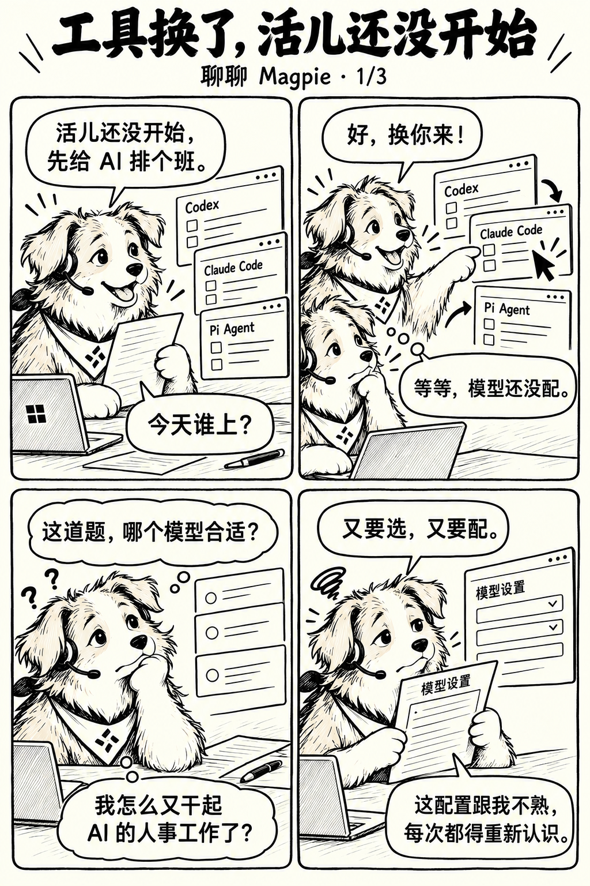
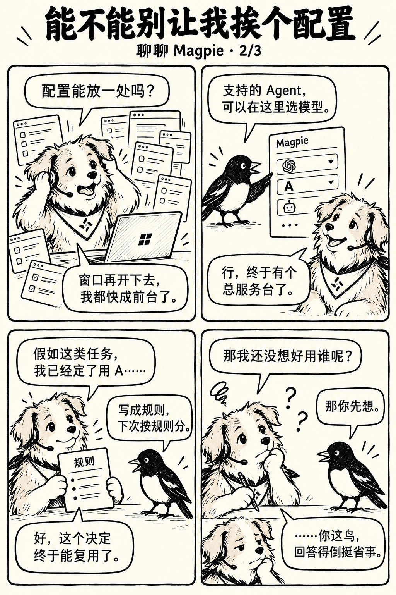
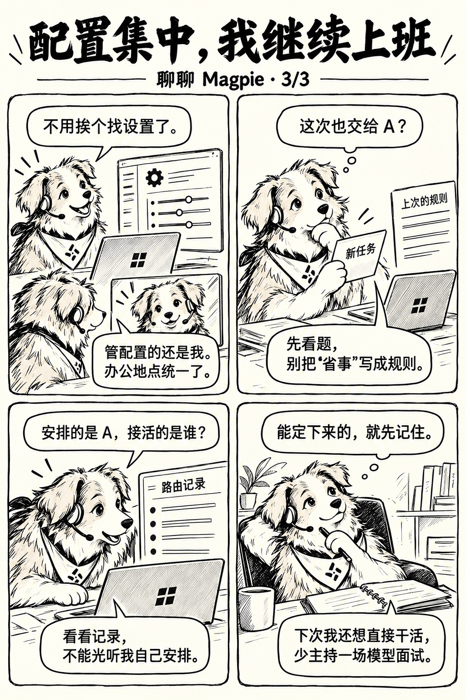
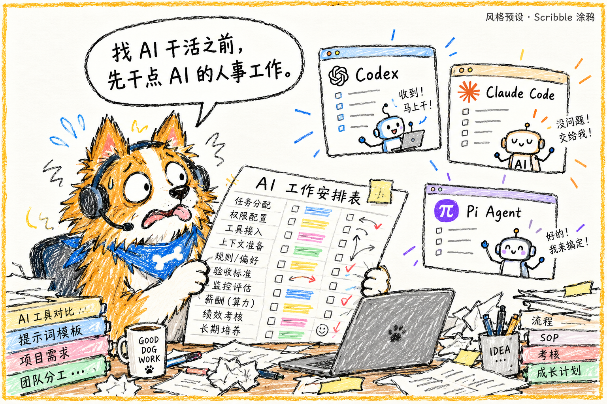
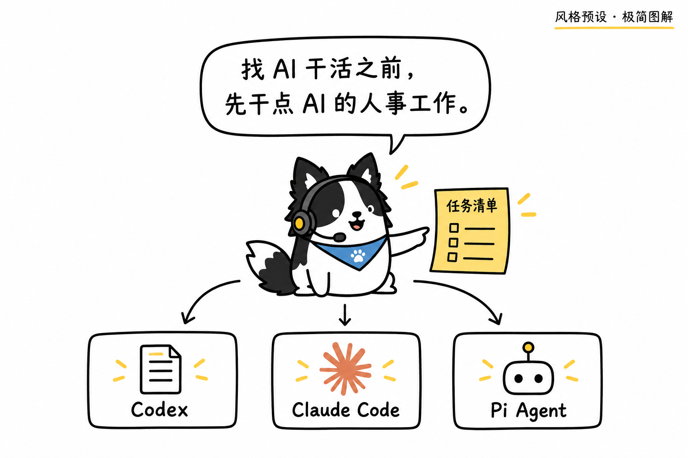
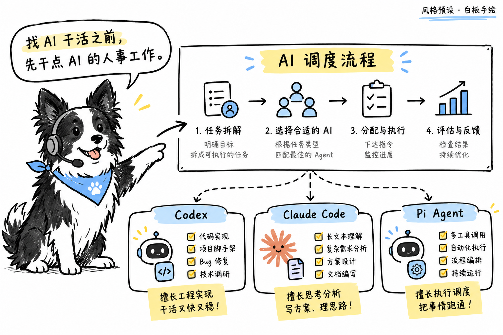

# bg-comic

**BG 漫画创作** · 仓库名、安装目录和技能调用名统一为 `bg-comic`。

**个人 IP 漫画图文 Skill**，把经历、文章或选题变成有角色、有对白、能连续阅读的漫画。

先把故事讲清楚，再选画风、定角色、做样图。六种手绘风格可选，也支持自定义。使用当前 Agent 的生图能力；**不能生图，就交付可直接复制的完整提示词。**

## 一句话安装（推荐）

把下面这句话发给你的 Agent：

> 请从 https://github.com/beganzzw/bg-comic 安装 bg-comic 技能到当前工具的用户级技能目录。先读取仓库说明，按当前环境适配安装路径，保留已有技能；安装后检查是否能识别，并告诉我如何调用。

需要宿主支持技能加载，Agent 具有网络访问和文件写入能力。安装后是否立即生效取决于宿主；需要刷新或重启会话时应明确说明，不能把文件复制成功当作已经加载。

## 效果示例

所有示例均为同套个人 IP 与工作流下的真实生成效果。点击图片可查看原图。

### 1. 完整连载叙事漫画（黑白手稿风）

讲述“AI 编程工具越用越多，我也开始忙着给 AI 排班”的完整 3 页长图，按 1/3、2/3、3/3 顺序连贯阅读：

| 1/3 · 工具换了，活儿还没开始 | 2/3 · 能不能别让我挨个配置 | 3/3 · 配置集中，我继续上班 |
| --- | --- | --- |
| [](examples/comic-01.png) | [](examples/comic-02.png) | [](examples/comic-03.png) |

---

### 2. 六种预设画风对照（同台词与同角色实作）

同主角、同情境（`“找 AI 干活之前，先干点 AI 的人事工作。”`），在不同视觉预设下的真实出图对照：

| Scribble 潦草涂鸦 | 治愈手绘 | 极简图解 |
| :---: | :---: | :---: |
| [](examples/style-scribble.png) | [](examples/style-healing.png) | [](examples/style-diagram.png) |
| 歪扭粗蜡笔线、夸张荒诞 | 柔和粉蜡笔与低饱和淡彩 | 豆形简化身躯、单色点缀与清晰图解 |

| 活力手绘 | 白板手绘（Excalidraw风） | 黑白手稿（见上方连载） |
| :---: | :---: | :---: |
| [](examples/style-vibrant.png) | [](examples/style-whiteboard.png) | [](examples/comic-01.png) |
| 粗黑描边、鲜明撞色块、动感十足 | 虚拟白板便签、虚线流程与导引标记 | 米白纸底、粗糙黑墨线、极简负空间 |

---

### 3. 公众号横版单图封面示例（900 × 383，2.35:1）

打破单一四格分镜，支持生成适配社媒头条的大图封面：

[](examples/cover-900x383.png)

> **素材说明**：示例中的角色由使用者提供，边牧形象不是技能的内置默认 IP；示例图片仅作效果参考，不适用本仓库 MIT 许可证。详见 [示例素材授权说明](examples/NOTICE.md)。

## 它负责什么

| 环节 | Skill 负责的事 | 仍取决于什么 |
| --- | --- | --- |
| 内容 | 提炼主题、组织个人叙事、编写幽默对白 | 用户提供的事实与素材 |
| 视觉 | 推荐画风、提取角色辨识点、组织分镜 | 用户选择与参考图质量 |
| 生成 | 把需求映射到当前 Agent 的图片工具 | 工具权限、模型能力和服务状态 |
| 检查 | 核对中文、页码、气泡、角色及画面数量 | 需要实际查看成图，不能只看调用成功 |
| 交付 | 连续阅读 HTML、图片和 ZIP 素材包 | 文件权限及可选的 Python 环境 |

**这是一套创作流程，不包含图片模型。** 不绑定本地服务、供应商或模型 ID，也不承诺零生图费用、角色绝对一致或中文零错误。

## 快速开始

### 1. 给一段内容，先定方向

> 使用 bg-comic，把下面这段经历改成漫画。先给我大纲，不生图。

可以提供文章、零散经历或选题。不需要一开始就上传角色图、选完全部参数。真实经历缺失时会先缩小范围或补问，不替你编造使用效果。

### 2. 到设计画面时，再选风格和角色

> 大纲可以。推荐一种适合轻松吐槽的风格，我会上传个人 IP 设定板。

六种风格只是预设。可以换色、换线条、提供参考图，也可以明确不要固定 IP。已确认的角色和画风不会反复询问。

### 3. 先看对白，再做样图

> 对白再幽默一点，别每格都像金句。确认以后先生成一张样图。

默认先检查一页的动作、风格、中文和气泡。用户确认后再展开整套；明确要求一次完成且素材齐全时，可以合并阶段。

### 4. 生成整套，交付预览

> 样图确认，继续剩下的页面，组合成连续阅读的文章预览。

当前 Agent 没有生图能力时，会直接交付逐页完整提示词和参考图使用说明，不强制安装其他服务。用户将图片带回后，可以继续检查和排版。

## 六种预设风格

| 风格 | 视觉特点 | 适合的内容 | 实作参考 |
| --- | --- | --- | --- |
| **黑白手稿** | 米白底、粗糙黑线、留白 | 个人经历、自嘲吐槽 | [连载大图](examples/comic-01.png) |
| **Scribble 潦草涂鸦** | 歪扭轮廓、稚拙比例、夸张动作 | 荒诞趣事、幽默封面 | [单幅样图](examples/style-scribble.png) |
| **治愈手绘** | 柔和线条、低饱和淡彩 | 工作日常、温和叙事 | [单幅样图](examples/style-healing.png) |
| **极简图解** | 简化人物、短标签和少量箭头 | 概念解释、简单对比 | [单幅样图](examples/style-diagram.png) |
| **活力手绘** | 粗线、少量亮色、动作突出 | 尝鲜体验、醒目封面 | [单幅样图](examples/style-vibrant.png) |
| **白板手绘** | 手绘线框、便签和连接关系 | 教程补图、流程说明 | [单幅样图](examples/style-whiteboard.png) |

未指定时会结合内容推荐一种，等待选择后再推进视觉制作，不自动套用黑白风。画风与四格、六格、单图封面等版式分开选择；切换风格不会自动改变文章主张。

## 需要准备哪些能力

| 需求 | 条件 |
| --- | --- |
| 大纲、对白和提示词 | 支持 SKILL.md 的 Agent |
| 直接生图 | Agent 已提供或已连接可用图片工具；费用按所用服务计算 |
| 根据角色图重绘 | 图片工具支持参考图；不支持时会说明限制 |
| HTML 与 ZIP | Python 3.9+，预览脚本仅用标准库，无第三方依赖 |
| 发布到外部平台 | 用户明确授权，且宿主有相应工具与权限 |

没有生图能力也能完成文字部分。本仓库不自动安装模型、不读取本机账号密钥、不要求启动特定 MCP 服务。

## 渐进式流程

理解内容 → 大纲 → 风格与角色 → 分镜对白 → 样图 → 整套交付。

只加载当前阶段需要的资料。缺 IP 不挡大纲；“先不生图”只交文字；修改一页不重做整套；已有确认直接沿用。生图异步任务需跟进到文件落盘或明确失败，“提交成功”不等于成图完成。

## 手动安装（备选）

将仓库放入宿主的用户级技能目录，文件夹命名为 `bg-comic`，保证其中直接包含 `SKILL.md`。目标目录已有同名技能时先检查，不覆盖已有修改。

WorkBuddy 可放在 `~/.workbuddy-ai/skills/bg-comic/`。其他 Agent 使用其官方文档规定的目录。本项目没有对所有宿主进行端到端测试。

也可先下载仓库，再让 Agent 按当前环境完成安装。仓库中的 `examples/` 是展示素材，不是运行时必须上传的角色。

## 导出预览

有图片后可运行：

```bash
python scripts/build_preview.py --title "我的漫画" --images /path/page1.png /path/page2.png --output-dir /path/new-output
```

结果保存在指定目录：

```text
new-output/
├── index.html          # 连续阅读页面
├── 01.png              # 按输入顺序复制的图片
├── 02.png
└── comic-package.zip   # HTML 与图片的便携素材包
```

图片实际扩展名随输入保留。使用全新输出目录；脚本拒绝覆盖同名成品。此脚本只排版已有图片，不负责调用模型生成图片。

## 常见问题与限制

- **没有个人 IP 能开始吗？** 可以先讨论主题和大纲。到角色设计阶段再上传，或明确选择无固定 IP、新设计角色。
- **没有生图工具怎么办？** 直接拿到每页独立提示词，不必自己拼接“同上风格”。参考图需在实际生图工具中另行上传。
- **能保证角色和中文准确吗？** 不能。需要逐张看图，检查变形、错字、重复窗口和气泡指向。文件能打开不代表画面正确。
- **为什么不是默认整套生成？** 先确认一张能减少批量返工；已授权一次完成时不强制重复确认。
- **服务报 EOF 是什么原因？** 仅凭该错误无法确定。应检查任务和产物，再区分文生图与参考图能力，不盲目重复提交。
- **会自动发布吗？** 不会。需要单独授权并确认宿主权限；更新草稿不代表公开发布成功。

## 按任务查文档

| 要做什么 | 文档 |
| --- | --- |
| 了解入口与阶段推进 | [SKILL.md](SKILL.md) |
| 选画风或自定义风格 | [风格预设](references/styles.md) |
| 写对白和分镜提示词 | [制作手册](references/playbook.md) |
| 适配图片工具或交付提示词 | [生图能力适配](references/image-capabilities.md) |
| 跟进生成、检查和交付 | [生产与验收](references/production.md) |
| 生成 HTML、ZIP | [预览脚本](scripts/build_preview.py) |

## 许可证与素材

代码与技能文档采用 [MIT License](LICENSE)。`examples/` 中图片适用 [独立授权说明](examples/NOTICE.md)，不属于 MIT 范围。仓库不包含角色原始设定板、聊天截图、账号配置或凭证。用户需确保有权使用自己上传的素材。

风格分类灵感来源见 [风格预设](references/styles.md)。这些预设为独立整理，不代表安装了其中链接指向的第三方技能。MIT 不授予第三方素材、平台服务或模型的使用权。
